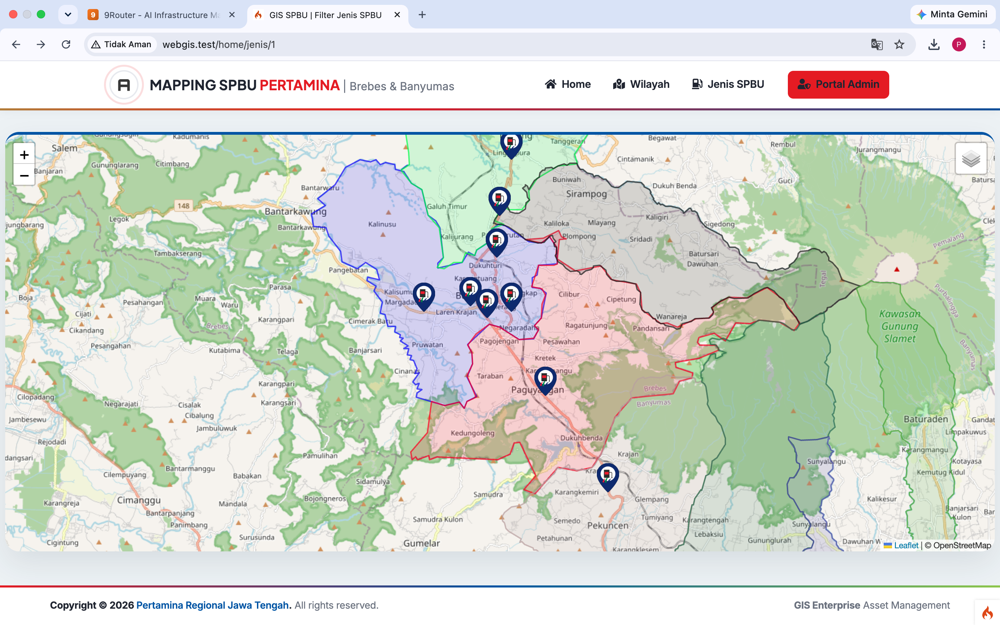
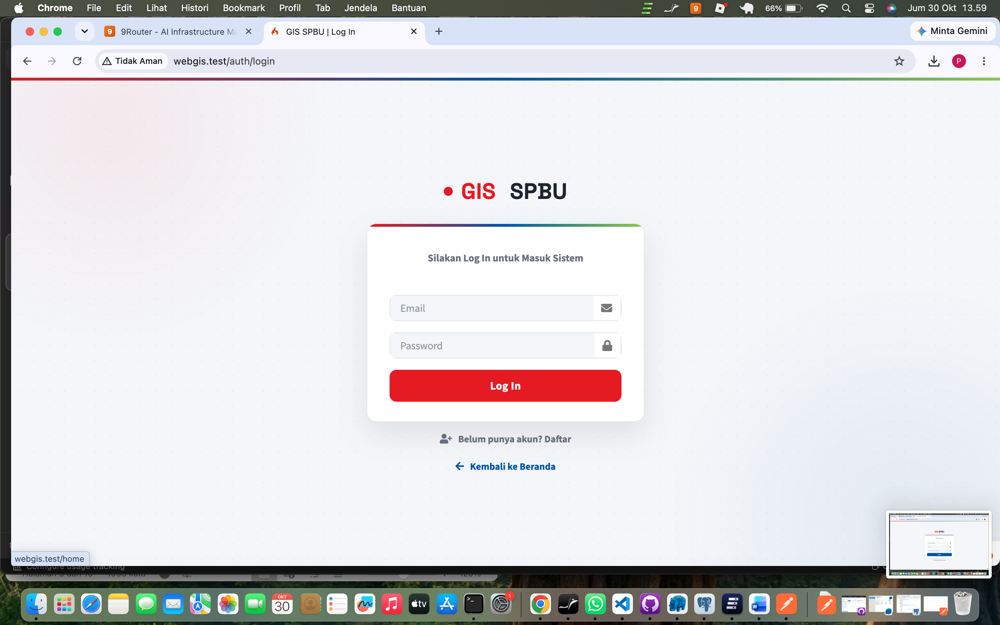
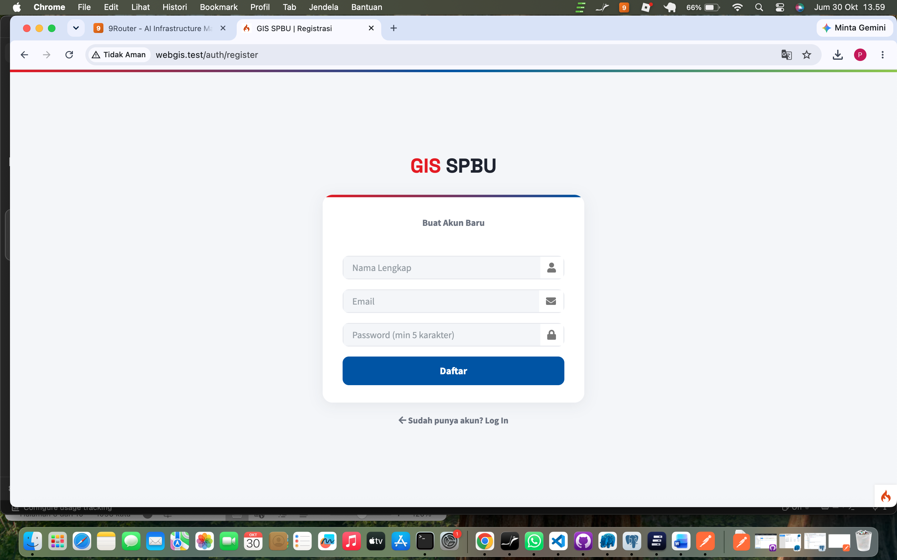
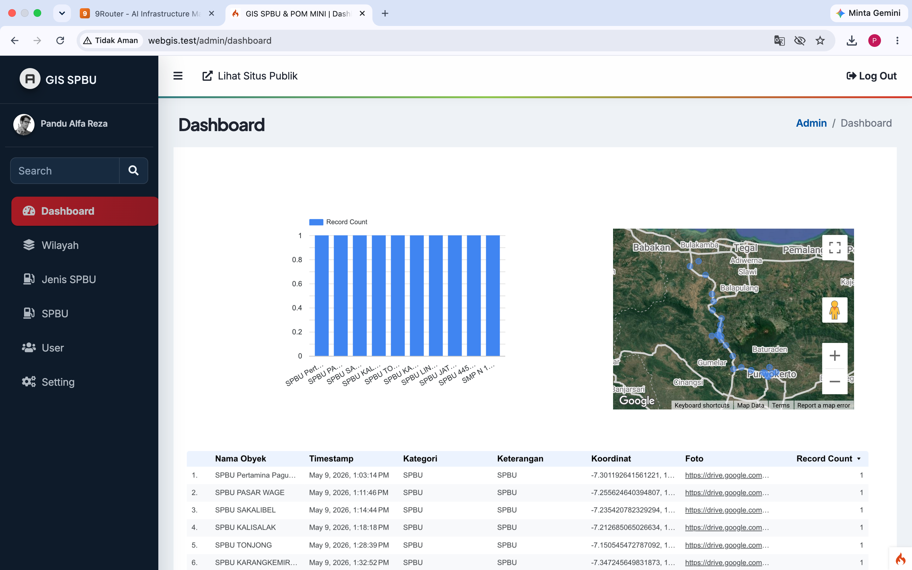
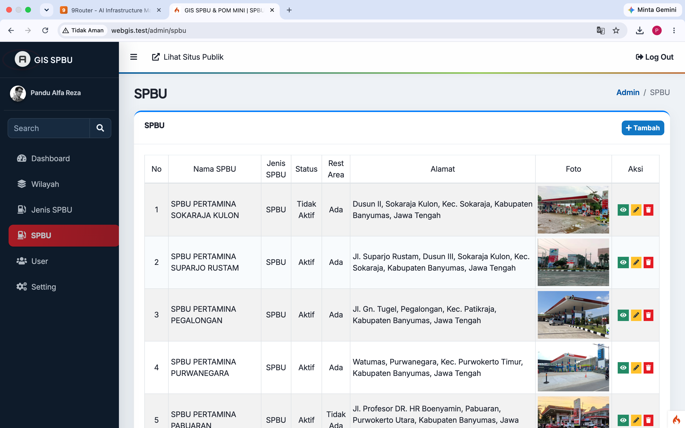
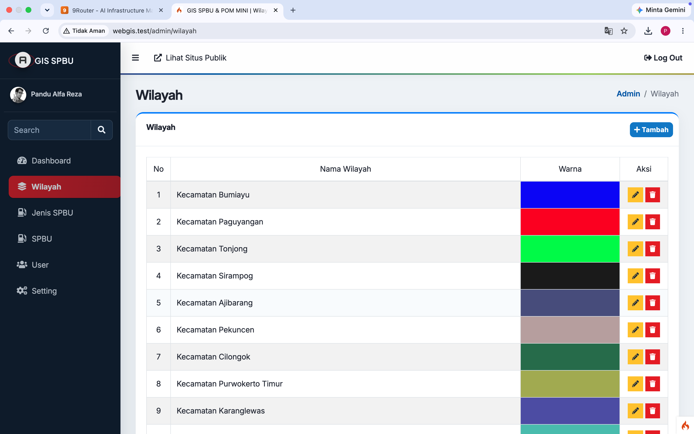
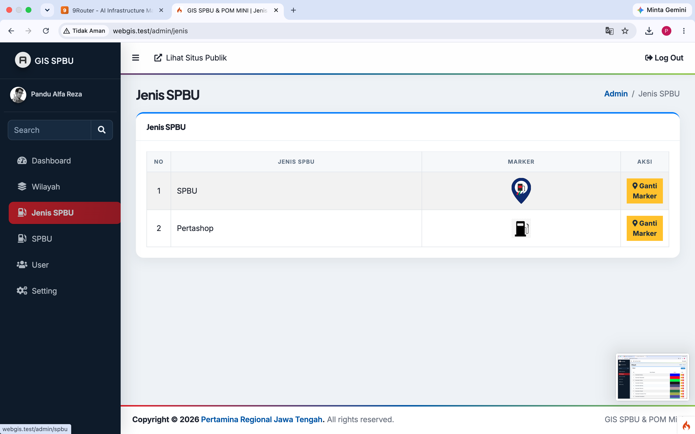

# WebGIS SPBU

WebGIS SPBU adalah website interaktif untuk menampilkan dan mengelola data lokasi SPBU di wilayah Brebes dan Banyumas. Aplikasi ini menyediakan peta digital, informasi detail SPBU, pengelolaan wilayah, pengelolaan jenis marker, serta dashboard admin.

## Latar Belakang

Data lokasi SPBU perlu disajikan dalam bentuk yang mudah dicari dan dipahami. WebGIS ini membantu pengguna melihat sebaran SPBU pada peta, memfilter berdasarkan wilayah atau jenis SPBU, dan melihat informasi detail setiap lokasi.

## Fitur

- Halaman publik WebGIS dengan peta Leaflet.
- Filter SPBU berdasarkan wilayah dan jenis SPBU.
- Detail lokasi SPBU beserta foto, alamat, status, dan koordinat.
- Login pengguna dan registrasi akun baru.
- Dashboard admin.
- CRUD data SPBU.
- CRUD data wilayah.
- CRUD data pengguna.
- Pengaturan titik pusat dan zoom peta.
- Validasi form di sisi server dan validasi dasar HTML di sisi klien.
- REST API untuk data SPBU dan data referensi.
- Tampilan responsif berbasis Bootstrap/AdminLTE.
- Integrasi dashboard Google Data Studio/Looker Studio.

## Teknologi

- PHP 8.2 atau lebih baru.
- CodeIgniter 4.
- PostgreSQL.
- HTML, CSS, JavaScript.
- Leaflet.js.
- Bootstrap/AdminLTE.

## Persiapan

Pastikan perangkat sudah memiliki:

- PHP dengan ekstensi `intl`, `mbstring`, `pgsql`, dan `curl`.
- PostgreSQL aktif.
- Composer.

## Konfigurasi dan Menjalankan

1. Clone repository:

   ```bash
   git clone https://github.com/pandualfarezaa/gis-spbu-ci4-pandu.git
   cd spirula
   ```

2. Install dependency:

   ```bash
   composer install
   ```

3. Salin konfigurasi environment dan sesuaikan database PostgreSQL:

   ```bash
   cp env .env
   ```

   Contoh konfigurasi:

   ```ini
   CI_ENVIRONMENT = development
   database.default.hostname = 127.0.0.1
   database.default.database = db_gis_spbu_ci4
   database.default.username = postgres
   database.default.password = password_postgresql
   database.default.DBDriver = Postgre
   database.default.port = 5432
   ```

4. Pastikan web server mengarah ke folder `public`.

5. Jalankan server development:

   ```bash
   php spark serve
   ```

6. Buka halaman utama melalui alamat yang ditampilkan server. Halaman login tersedia di `/auth/login`, registrasi di `/auth/register`, dan dashboard di `/admin/dashboard`.

## Endpoint API

- `GET /api/spbu`
- `GET /api/spbu/{id}`
- `GET /api/spbu/geojson`
- `POST /api/spbu`
- `PUT /api/spbu/{id}`
- `DELETE /api/spbu/{id}`
- `GET /api/jenis`
- `GET /api/provinsi`
- `GET /api/kabupaten`
- `GET /api/kecamatan`
- `GET /api/wilayah`
- `GET /api/wilayah/{id}`

## Dokumentasi dan Screenshot

### Halaman Utama WebGIS



### Login



### Registrasi



### Dashboard Admin



### Data SPBU



### Data Wilayah



### Jenis SPBU



Screenshot yang disertakan meliputi:

- Halaman utama peta WebGIS.
- Halaman login dan registrasi.
- Dashboard admin.
- Halaman daftar dan form SPBU.
- Halaman detail SPBU.
- Halaman pengelolaan wilayah.
- Contoh respons REST API.

Dokumen spesifikasi kebutuhan sistem: https://docs.google.com/document/d/1KFh9qpu_TMY9iqrI_-fXEdwgCXsuQFNE652wyKPLEI4/edit?usp=sharing

## Struktur Aplikasi

- `app/Controllers` berisi controller aplikasi dan API.
- `app/Models` berisi akses data database.
- `app/Views` berisi tampilan aplikasi.
- `app/Config/Routes.php` berisi daftar route.
- `public` berisi entry point dan asset publik.
- `writable` berisi cache, log, dan session.
